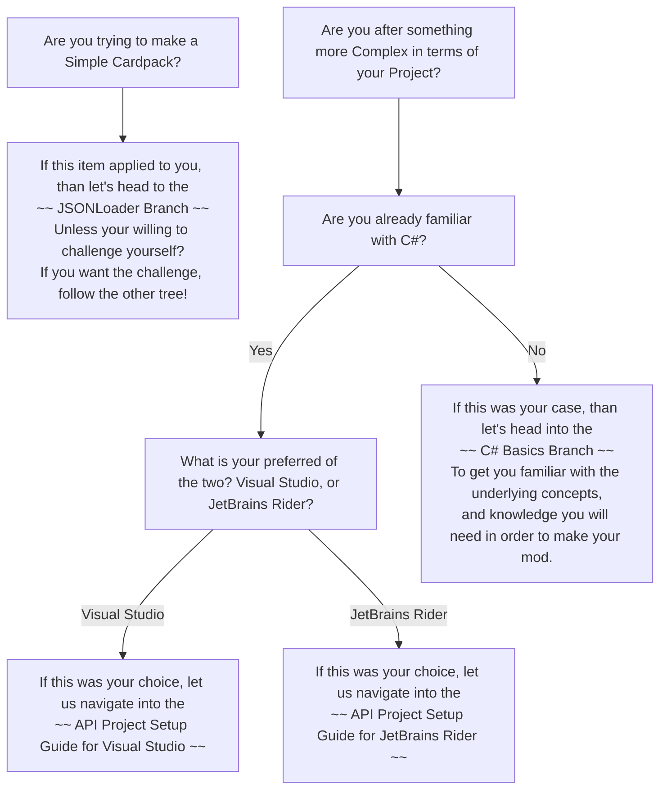

# Inscryption API Wiki

Hey there, and welcome to the Inscryption Modding and API Wiki. This is your one stop hub for all things related to the API. The following are some quick links:

* [Inscryption API Documentation](api/index.md)
* [Inscryption Community Patch Documentation](community/index.md)
* [Inscryption Modding Wiki](wiki/index.md)

Some other links you may find extremely valuable are as follows:
* [Inscryption Modding Discord](https://discord.gg/QrJEF5Denm)
* [Thunderstore Package](https://thunderstore.io/c/inscryption/p/API_dev/API/)
* [GitHub Repository](https://github.com/InscryptionModding/InscryptionAPI)

How can you contribute to the wiki? Well for starters you can find the Wiki end of our setup [here](https://github.com/InscryptionModding/InscryptionAPI/tree/main/docs), the only relevant part of this setup you may need to interact with is `wiki` or any `index.md` files. The rest of it leave untouched unless you ***know*** what you are doing. Once you have a markdown file open its straight forward editing as long as you know how Markdown works.

___

## Inscryption API

This plugin is a BepInEx plugin made for Inscryption as an API. This is the de-facto standard API for Inscryption modders.

It can currently create and modify:
- Cards
- Abilities
- Appearance behaviours
- Stat Icons
- Challenges
- Starter Decks
- Regions
- Encounters
- Totem Tops
- Consumable Items
- Gramophone Tracks
- Slot Modifications
- Talking Cards
- Custom Costs
- Custom Rulebook Pages
- Rulebook Redirects/Hyperlinks
- And much more!

Additionally, a number of quality-of-life patches from the community are included with each release.

___

## Getting Started (Users)

The following are links to articles relevant for Users of the API. Namely covering the topic of installation of mods for Inscryption that utilize the API. This also includes how to install BepInEx, the underlying framework for all Inscryption Mods, for all the given scenarios the Articles tackle.

***FOR LINUX AND STEAMDECK:*** Ensure that the game is set to run using `Proton` in the game settings on steam. Should be a setting like this: `Change launch behaviour` -> `Proton`.

* [Installing With a Mod Manager](https://inscryptionmodding.github.io/InscryptionAPI/wiki/getting_started/users/installing_with_a_mod_manager.html)
* [Installing Manually on Windows (x86)](https://inscryptionmodding.github.io/InscryptionAPI/wiki/getting_started/users/installing_manually_on_windows_x86.html)
* [Installing Manually on Windows (x64)](https://inscryptionmodding.github.io/InscryptionAPI/wiki/getting_started/users/installing_manually_on_windows_x64.html)
* [Installing on The Steam Deck](https://inscryptionmodding.github.io/InscryptionAPI/wiki/getting_started/users/installing_on_the_steam_deck.html)
* [Installing on Mac & Linux](https://inscryptionmodding.github.io/InscryptionAPI/wiki/getting_started/users/installing_on_mac_and_linux.html)

___

## Getting Started (Modders)

So your interested in learning how to modify Inscryption? Well this section of our guide should come in really handy for you! Albeit if your an artist, a developer, or just passing by, we hope you find these guides of value.

First off let's get you to the right branch of the guides. Let's get some groundwork's out of the way now. Based on the item below, you should be funneled to the level your after. *Note for the IDE Question, if you have familiarity with [IntelliJ Idea](https://www.jetbrains.com/idea/), you'll likely prefer JetBrains Rider.*

### Modding Resources
- [Inscryption Modding Discord](https://discord.gg/QrJEF5Denm)
- [Inscryption Modding Wiki](https://inscryptionmodding.github.io/InscryptionAPI/wiki/)
- [BepInEx documentation](https://docs.bepinex.dev/)
- [Harmony patching article](https://harmony.pardeike.net/articles/patching.html)
- [Example Mod using C#](https://github.com/debugman18/InscryptionExampleMod)
- [Vanilla and Modded Enumerations](https://github.com/SaxbyMod/SabyModEnums)

___

## Modded Save File
With this API installed, an additional 'modded save file' will be created by the game. This file will be found in the 'BepInEx' subdirectory, and contains all save data created by mods that use this API. This file will not automatically be synced to the cloud by Steam.

___

## Community Patches
The following patches from the Inscryption modding community have been included in this package to improve the overall quality-of-life for modding and compatibility.

### SigilArtPatch by MADH95Mods
Fixes the art for abilities that previously only appeared in Act 2 so they appear correctly in Act 1 and Act 3

### Conduit Attack Fix by MADH95Mods
Fixes the behavior of conduits so they function correctly in Act 1.

### Activated Sigil Fix by MADH95Mods
Allows activated sigils to work correctly in Act 1 and Act 3 by clicking the sigil icon on the card.

### AnthonysLatchFix by AnthonyPython
Fixes latch sigils to work in Act 1

### Sigil Art Fix by Memez4Life
Allows up to 8 sigils to be displayed on cards and adds the option to display merged sigil stamps at the bottom of the card instead of over the artwork (see the config files for more information).

### Visually Stackable Sigils by divisionbyz0rro
Combines multiple instances of the same sigil on a single card into a single sigil with a number to free up space on the card.

### Cost Render Fix by Void Slime
Displays hybrid cost cards correctly and makes energy and mox show up on act 1 cards

### Cost Choice Node Fix by Void Slime
If energy/mox cards are in the Act 1 pool, energy and mox card choice nodes will be added to the cost choice node in Act 1.

### Sniper Sigil Fix by SpecialAPI
Displays targets for attacks made with the sniper sigil in Act 1.

### Act 1 Sentry Fixes by WhistleWind
Fixes a number of bugs caused by the Sentry ability being used in Act 1.

### Multi-Act Sigil Compatibility Fixes by WhistleWind
Fixes a number of sigils to be usable in all Acts. Sigils include: Mental Gemnastics, Tidal Lock, Hoarder, Vessel Printer, Amorphous, Handy.

### Fledgling Sigil Fixes by WhistleWind
Fixes Fledgling in Act 2 to show the correct number of turns until a card evolves, up to 3. Also changes its description to show the correct number of turns.

### OverridePixelAbilityIcons by WhistleWind
Fixes the OverrideAbilityIcon method to work in Act 2.

### Temporary Mod Fixes by WhistleWind
Fixes issues related to using temporary mods in Act 2 or to add custom decals

___

## Using the API

Inscryption API 2.0 tries to have you use the original game's objects as much as possible. For example, there are no more 'NewCard' and 'CustomCard' objects; instead, you are responsible to create CardInfo objects yourself and add them.

The API does provide a number of helper methods to make this process simpler for you.

For more information, please check out the wiki: [Here](https://inscryptionmodding.github.io/InscryptionAPI/wiki/), and if you need any help with anything related to the API send a message over in [Inscryption Modding Discord](https://discord.gg/QrJEF5Denm).

___

## Contribution

### How can you help?
Use the plugin and report bugs you find! Ping us on the [Inscryption Modding Discord](https://discord.gg/QrJEF5Denm) server in the api channel with what you find.

### But really, I want to help develop this mod!
Great! We're more than happy to accept help. Either make a pull request to the API's [GitHub page](https://github.com/InscryptionModding/InscryptionAPI) or come join us over in the [Inscryption Modding Discord](https://discord.gg/QrJEF5Denm).

### Can I donate?
Donations are totally not needed, this is a passion project before anything else.

___

## Contributors
Original version by cyantist

Contributors and builders of API 2.0:
- BobbyShmurner
- divisionbyz0rro
- Eri
- IngoH
- JamesVeug
- julian-perge
- KellyBetty
- Nevernamed
- SpecialAPI
- Void Slime
- WhistleWind
- Windows10CE
- Keks307
- Creator/Chaosyr/SaxbyMod/The Stoat Lord/ThinCreator3483
- stillrinny
- R3b00t3d-kawaii

___