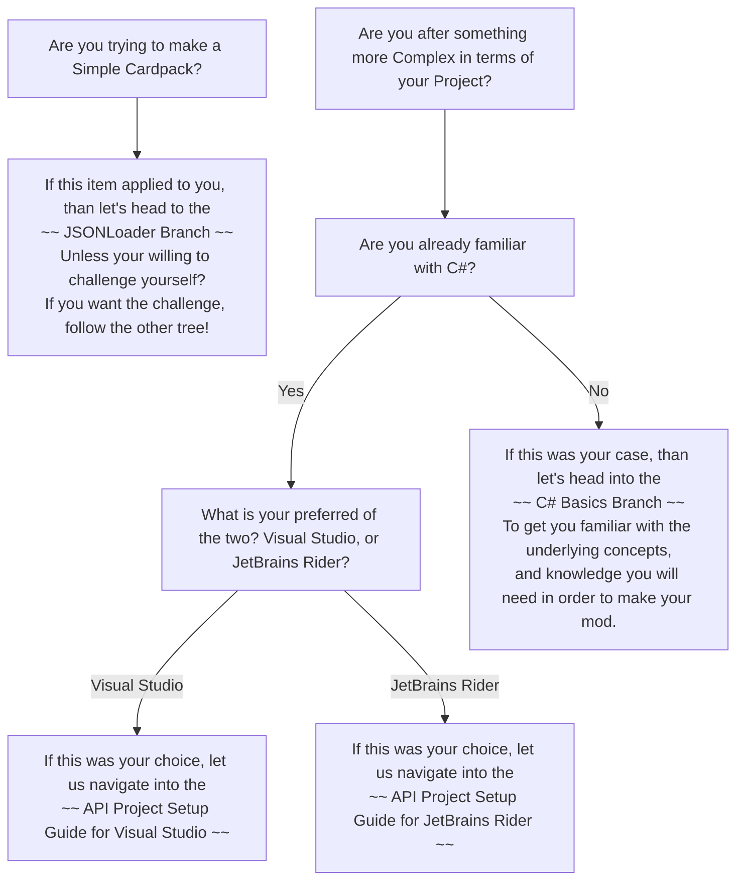

# Getting Started

This set of articles covers getting started for both users and modders. This page acts as the homepage that links out to them. You can switch between them through the table of contents, which is on the left hand of the screen. You can also switch to other articles through the table of contents.

## Getting Started (Users)

The following are links to articles relavent for Users of the API. Namely covering the topic of installation of mods for Inscryption that utilize the API. This also includes how to install BepInEx, the underlying framework for all Inscryption Mods, for all of the given scenarios the Articles tackle.

***FOR LINUX AND STEAMDECK:*** Ensure that the game is set to run using `Proton` in he game settings on steam. Should be a setting like this: `Change launch behaviour` -> `Proton`.

* [Installing With a Mod Manager](users/installing_with_a_mod_manager.md)
* [Installing Manually on Windows (x86)](users/installing_manually_on_windows_x86.md)
* [Installing Manually on Windows (x64)](users/installing_manually_on_windows_x64.md)
* [Installing on The Steam Deck](users/installing_on_the_steam_deck.md)
* [Installing on Mac & Linux](users/installing_on_mac_and_linux.md)

## Getting Started (Modders)

So your interested in learning how to modify Inscryption? Well this section of our guide should come in really handy for you! Albeit if your a artist, a developer, or just passing by, we hope you find these guides of value.

First off let's get you to the right branch of the guides. Let's get some groundworks out of the way now. Based on the item below, you should be funneled to the level your after.

Plain-Text Version

1. Are you trying to make a Simple Cardpack?
    - If this item applied to you, than let's head to the [JSONLoader Branch](modders/jsonloader_projects/index.md) shallst we? Unless your willing to challenge yourself?
2. Are you after something more Complex in terms of your Project?
    1. Are you already familiar with C#?
        * If `Yes` was your choice:
            1. What is your preferred of the two? Visual Studio, or JetBrains Rider?
                * If `Visual Studio` was your choice:
                    - If this was your choice, let us navigate into the [API Project Setup Guide for Visual Studio](modders/api_projects_vs_edition/index.md).
                * If `JetBrains Rider` was your choice:
                    - If this was your choice, let us navigate into the [API Project Setup Guide for JetBrains Rider](modders/api_projects_rider_edition/index.md).
        * If `No` was your choice:
            - If this was your case, than let's head into the [C# Basics Branch](modders/c_sharp_basics/index.md), to get you familiar with the underlying concepts and knowledge you will need in order to make your mod. 

### Modding Resources
- [Inscryption Modding Discord](https://discord.gg/QrJEF5Denm)
- [BepInEx documentation](https://docs.bepinex.dev/)
- [Harmony patching article](https://harmony.pardeike.net/articles/patching.html)
- [Example Mod using C#](https://github.com/debugman18/InscryptionExampleMod)
- [Vanilla and Modded Enumerations](https://github.com/SaxbyMod/SabyModEnums)
