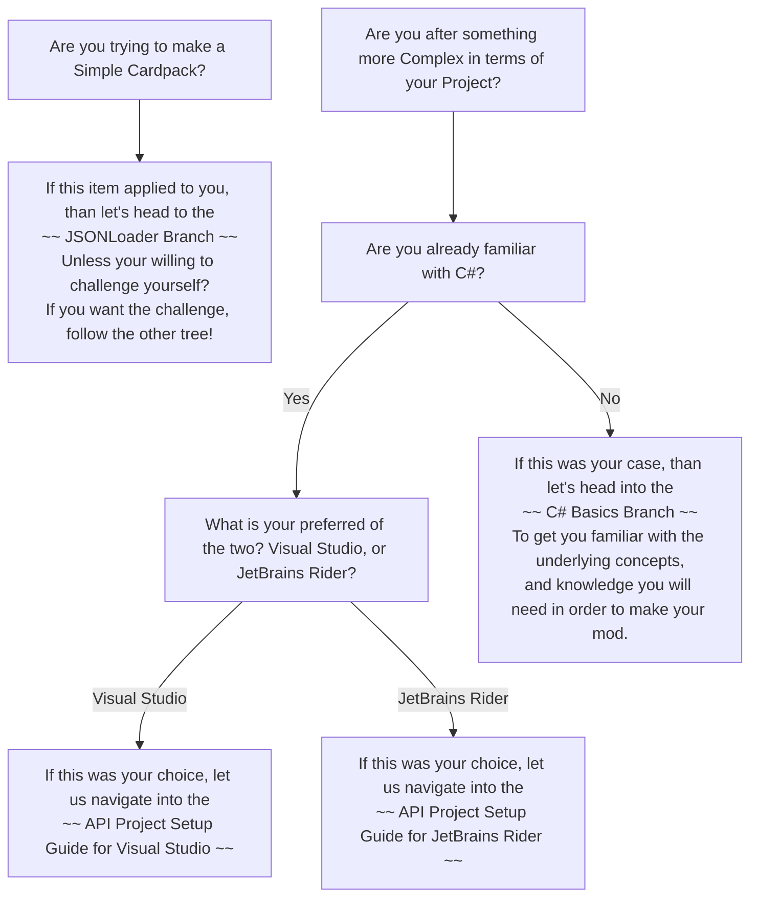

# Getting Started (Modders)

So your interested in learning how to modify Inscryption? Well this section of our guide should come in really handy for you! Albeit if your a artist, a developer, or just passing by, we hope you find these guides of value.

First off let's get you to the right branch of the guides. Let's get some groundworks out of the way now. Based on the item below, you should be funneled to the level your after. *Note for the IDE Question, if you have familiarity with [IntelliJ Idea](https://www.jetbrains.com/idea/), you'll likely prefer Jetbrains Rider.*

___

## Modding Resources
- [Inscryption Modding Discord](https://discord.gg/QrJEF5Denm)
- [BepInEx documentation](https://docs.bepinex.dev/)
- [Harmony patching article](https://harmony.pardeike.net/articles/patching.html)
- [Example Mod using C#](https://github.com/debugman18/InscryptionExampleMod)
- [Vanilla and Modded Enumerations](https://github.com/SaxbyMod/SabyModEnums)

___